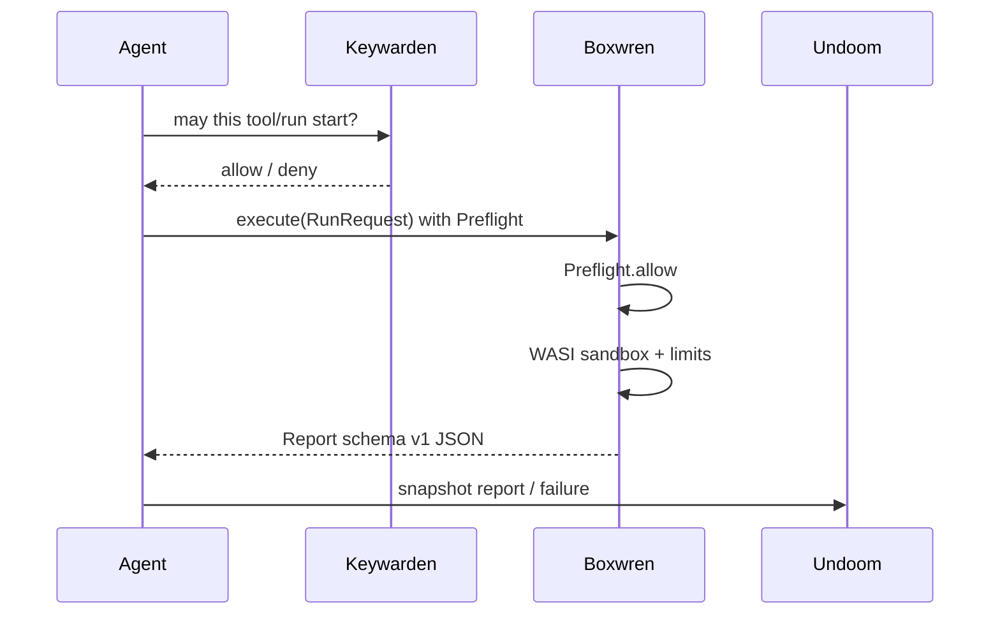

# Integrations: Keywarden and Undoom

## Keywarden

Boxwren contains execution. Keywarden decides whether an agent may call a tool
or start a run.

- Library: implement [`boxwren::Preflight`](../crates/boxwren/src/hooks.rs) and
  call `Engine::execute_with_preflight`. See
  [`examples/keywarden_preflight.rs`](../crates/boxwren/examples/keywarden_preflight.rs).
- Hosted: set `KEYWARDEN_URL` on `boxwren-server`. Each `POST /v1/runs` posts
  `{ "action": "boxwren.run", "account_id", "entry" }` and expects 2xx to proceed.

Policy is **not** rewritten inside WASI `path_*` or socket imports.

## Undoom

Reports are schema version 1 JSON (`status`, `fuel_used`, `peak_memory`,
`events`, `warnings`, …). Undoom can snapshot a report without depending on
this crate:

| Boxwren field | Undoom use |
| --- | --- |
| `schema_version` | Reject unknown schemas |
| `status.kind` | Failure signature / outcome |
| `events[]` | Unexpected tool / capability attempts |
| `stdout` / `stderr` | Redact then store |
| `fuel_used` / `duration_ms` | Resource regression |

Hosted runs store `report_json` per row; export that blob into Undoom’s store
API or write it to `.undoom` from the agent process after `execute`.
